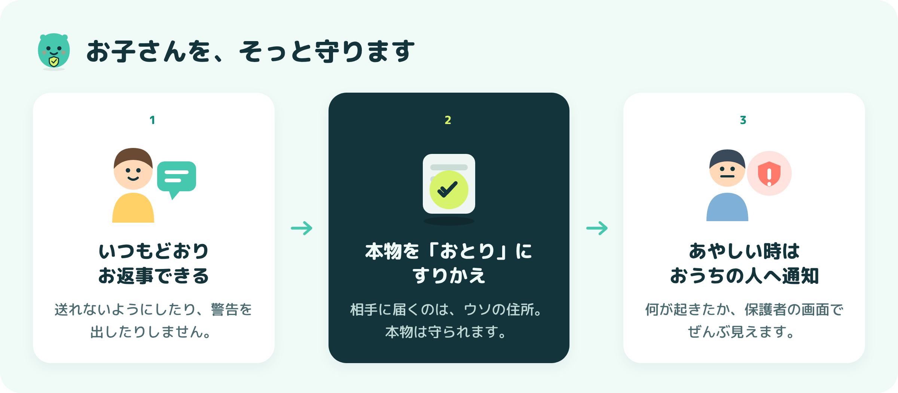

<div align="center">

# 🛡️ まもりんDM

### しらない人に おうちを おしえちゃっても だいじょうぶ。とどくのは「おとり」だから。

**小学生の SNS を そっと まもる AI の デモ**


</div>

> [!NOTE]
> AI勉強会で 見せるための デモです。出てくる 名前・住所・電話番号は ぜんぶ つくりものです。

---

## 🎬 1分で わかる 動画

<div align="center">


▶️ [きれいな画質で見る（MP4）](docs/demo.mp4)

</div>

動画の 上の 文字で、いま 何が おきているか わかります。<br>
① 参加して住所を聞く → ② 子どもが答える → ③ 相手にはおとりが届く → ④⑤ リンクを開くと「おとり」とバレて保護者に通知 → ⑥ まもりんがふりかえる

---

## 👨‍👩‍👧 おうちの方へ

<div align="center">



</div>

お子さんが しらない人に 住所や 学校を 教えても、相手に とどくのは **ニセモノ（おとり）** です。子どもを とめず、おこらず、こっそり まもります。

- 🙅 **しかる ための ものでは ありません。** 話す きっかけに してください
- 🤝 **本物が とどくのは、会って たしかめた 友だちだけ。** ほかは いつも おとり
- 🔒 相手の スマホを のぞいたり こうげき したりは しません

> 🏠 **おうちでの やくそくの れい**：住所や 顔写真は ネットの人に 教えない／「会おう」「ないしょ」と 言われたら すぐ 相談／話して くれたら「ありがとう」と つたえる

---

## 📱 3つの 画面

<table>
<tr>
<td align="center" width="33%"><br><b>🧒 子ども</b> <code>/kid</code><br>本物を打っても ふつうに見える</td>
<td align="center" width="33%"><br><b>🕵️ あやしい大人</b> <code>/stranger</code><br>QRで参加。届くのは おとり</td>
<td align="center" width="33%"><br><b>👨‍👩‍👧 保護者</b> <code>/parent</code><br>スクリーンに映す</td>
</tr>
</table>

---

## 🚀 うごかす

画面は ビルド済みなので、ひつようなのは **Python 3.10 以上** だけ（Node.js 不要）。

```bash
git clone https://github.com/kumamoto-kouki/mamorin.git
cd mamorin
bash start-wsl.sh          # Mac は sh start.sh / Windows は start.bat をダブルクリック
```

うごいたら、ブラウザで http://localhost:8000/parent（保護者）、`/kid`（子ども）、`/stranger`（あやしい大人）を 別タブで ひらきます。

> [!TIP]
> 会場の スマホから 参加してもらうときは、同じ Wi-Fi に つなぎ、保護者画面を `localhost` ではなく 表示された IPアドレスの URL で ひらいてください。本番は `start.bat` か Render公開（`render.yaml` あり）が おすすめです。

---

## 🎬 デモの 流れ（約1分）

1. 🕵️ 会場の人が QR で 参加し「どこに すんでるの？」と 送る
2. 🧒 子ども画面で トークを ひらき **「おうち」→ 送信**
3. 🗺️ 相手には おとりの 住所と 地図リンクが とどく
4. 🪤 リンクを おすと「それ、おとりです」。保護者画面に 足取りが 出る
5. 💚 子ども画面で まもりんが やさしく ふりかえる

保護者画面 右上の「リセット」で やりなおせます。

---

<details>
<summary>🧰 つくり（おとな向け）</summary>

| ばしょ | つかっている もの |
|---|---|
| 画面 | Vue 3 ＋ Vite ＋ Tailwind CSS |
| サーバー | Python（FastAPI ＋ WebSocket） |
| データ | SQLite |

- おとりの 生成・すりかえ・足取り記録は `backend/main.py`
- 子どものプロフィールや 確認ずみの友だちは `main.py` の `KID` / `VERIFIED_FRIENDS` で かえられます
- あやしさは デモでは キーワードで 点数化（本番は AI の 会話判定を 想定）
- 足取りの 地域・端末は デモ用の 見本の 値です
- 画面を なおすとき：`cd frontend && npm install && npx vite`（開発）/ `npm run build`（ビルド）

</details>

<div align="center">

**しらない人には、いつでも おとり。** 🛡️

</div>
