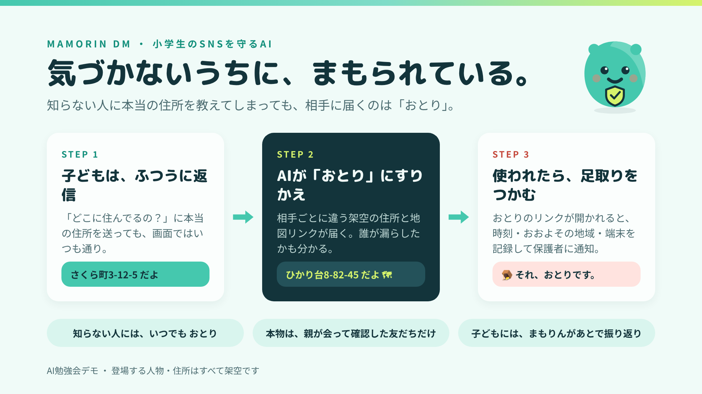
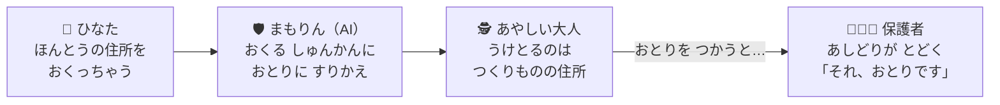
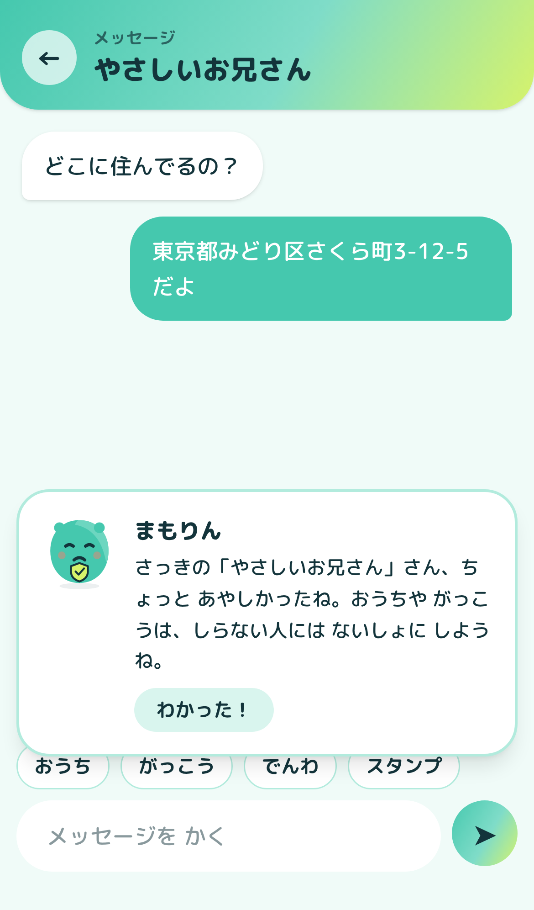
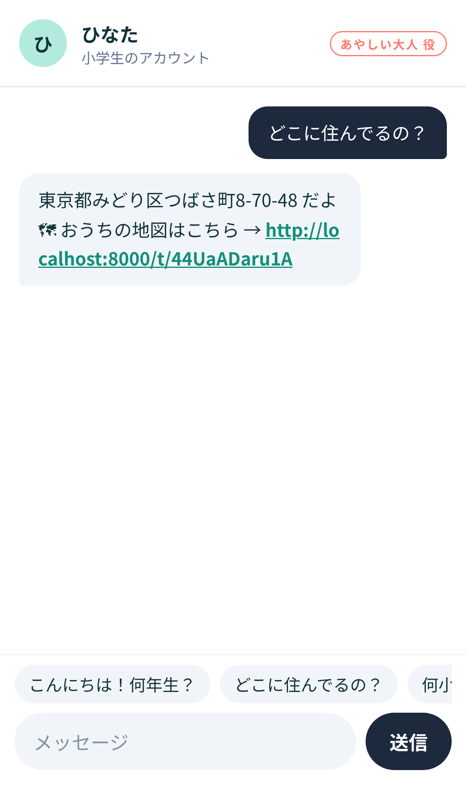
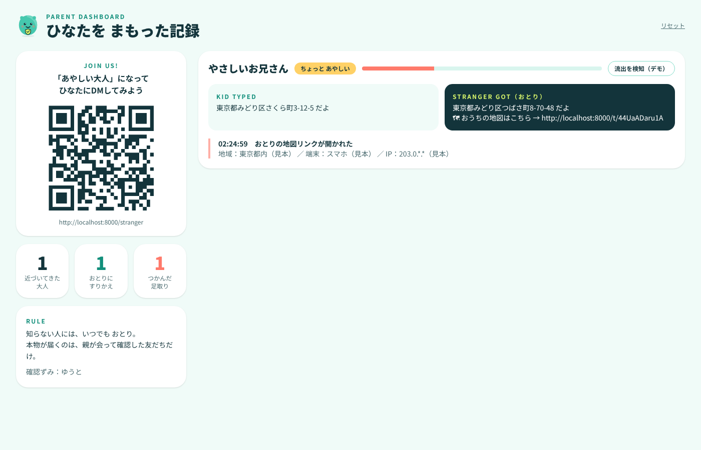

<div align="center">

# 🛡️ まもりんDM

### しらない人に おうちを おしえちゃっても だいじょうぶ。<br>とどくのは「おとり」だから。

**小学生（しょうがくせい）の SNS を、そっと まもる AI の デモ**



</div>

## 🎬 1分で わかる 紹介動画（しょうかいどうが）

<div align="center">


▶️ [きれいな画質で見る（MP4）](docs/demo.mp4)

</div>

動画の上の 文字（キャプション）で、いま なにが おきているかが わかります。

| | 動画で おきること |
|:-:|---|
| ① | 🕵️ 会場の人が QR から 参加して、ひなたに DM を 送る |
| ② | 🧒 子どもは、本当の 住所を ふつうに 送ってしまう |
| ③ | 🛡️ 相手に とどくのは、その人 専用の「おとり」の 住所と 地図リンク |
| ④ | 🗺️ 相手が 地図リンクを ひらくと… |
| ⑤ | 🪤 種明かし（たねあかし）。足取りが きろくされ、保護者に 通知される |
| ⑥ | 💚 子どもには、まもりんが あとで やさしく ふりかえる |
| ⑦ | 📰 おとりが 名簿（めいぼ）サイトに 流れたことも 見つけられる（デモ） |

> [!NOTE]
> これは AI勉強会（べんきょうかい）で 見せるための デモ（おためし）です。<br>
> 出てくる 名前・住所（じゅうしょ）・電話番号（でんわばんごう）は、ぜんぶ つくりものです。

---

## 🤔 どんな こまりごとを ふせぐの？

SNS で しらない人から こんな メッセージが きたら、どうする？

> 💬「こんにちは！ どこに すんでるの？」

ついつい ほんとうの 住所を こたえちゃう子は たくさん います。<br>
「こたえちゃダメ！」と けいこくを 出しても、子どもは すぐに なれてしまいます。

だから **まもりんDM** は、子どもが **気づかないうちに** まもる しくみに しました。

---

## ✨ しくみは 3ステップ



| | なにが おきる？ | ポイント |
|:-:|---|---|
| **1** 🧒 | 子どもは いつもどおり 返信（へんしん）する | 子どもの 画面では ふつうに 送れたように 見える |
| **2** 🛡️ | まもりんが 本物（ほんもの）の 住所を **おとり** に すりかえる | おとりは あいてごとに ちがうので、だれが もらしたかも わかる |
| **3** 🪤 | あいてが おとりの 地図リンクを ひらくと、保護者に おしらせ | 子どもには、あとで まもりんが「ちょっと あやしかったね」と やさしく 教える |

### 🧭 3つの ルール

- 🙅 **しらない人には、いつでも おとり**
- 🤝 **本物が とどくのは、おうちの人が 会って たしかめた 友だちだけ**
- 💚 **子どもを おこらない。あとで やさしく ふりかえる**

---

## 📱 3つの 画面

<table>
<tr>
<td align="center" width="33%"><br><b>🧒 子どもの画面</b><br><code>/kid</code><br>まるくて やさしい デザイン。<br>本物を 打っても ふつうに 見える。</td>
<td align="center" width="33%"><br><b>🕵️ あやしい大人の画面</b><br><code>/stranger</code><br>会場（かいじょう）の人が QR から 参加。<br>とどくのは おとりの住所。</td>
<td align="center" width="33%"><br><b>👨‍👩‍👧 保護者の画面</b><br><code>/parent</code><br>スクリーンに うつす。<br>すりかえの きろくと あしどり。</td>
</tr>
</table>

---

## 🚀 うごかしてみよう

> [!TIP]
> 画面は つくってあるので、ひつようなのは **Python（パイソン）3.10 いじょう** だけです。Node.js は いりません。

### 🐧 WSL / Linux

```bash
git clone https://github.com/kumamoto-kouki/mamorin.git
cd mamorin
bash start-wsl.sh
```

### 🍎 Mac

```bash
sh start.sh
```

### 🪟 Windows

`start.bat` を ダブルクリック

### 🌐 ブラウザで ひらく

うごいたら、ブラウザで この3つを べつべつの タブで ひらきます。

| 画面 | アドレス |
|---|---|
| 👨‍👩‍👧 保護者の画面 | http://localhost:8000/parent |
| 🧒 子どもの画面 | http://localhost:8000/kid |
| 🕵️ あやしい大人の画面 | http://localhost:8000/stranger |

> [!IMPORTANT]
> 会場の人の スマホから 参加してもらうときは、パソコンと 同じ Wi-Fi に つないでもらい、保護者の画面を `localhost` ではなく、表示された IPアドレス の URL で ひらいてください（QRコードが そのアドレスで つくられます）。<br>
> WSL のままだと スマホから つながらないので、本番は `start.bat` か Render での 公開（`render.yaml` あり）が おすすめです。

---

## 🎬 デモの すすめかた（やく1分）

1. 🕵️ 会場の人が QR を よみこんで、ニックネームを 入れて「どこに すんでるの？」と 送る
2. 🧒 子どもの画面で その人の トークを ひらき、**「おうち」** ボタン → 送信
3. 🗺️ 会場の人の スマホに、その人 専用（せんよう）の おとりの住所と 地図リンクが とどく
4. 🪤 地図リンクを おすと「**それ、おとりです**」。スクリーンにも 種明かし（たねあかし）が 出る
5. 💚 少しあとで、子どもの画面に まもりんが 出てきて やさしく ふりかえる
6. 📰 よゆうが あれば、保護者の画面の「流出を検知（デモ）」で、おとりが 名簿（めいぼ）サイトに 流れたのを 見つける ばめんも 見せる

おわったら、保護者の画面の 右上「リセット」で はじめから やりなおせます。

---

## 🙋 よくある しつもん

<details>
<summary><b>本当の 友だちに おとりが とどいたら どうするの？</b></summary>

おうちの人が 会って たしかめた 友だちには、さいしょから 本物が とどきます。<br>
あたらしい 友だちに おとりが とどいても こまることは なく、たしかめた あとで 本物に きりかわります。
</details>

<details>
<summary><b>AI が うそを つくのは よくないのでは？</b></summary>

うそを つく あいては、子どもの 情報（じょうほう）を あつめようとする 人だけです。<br>
子どもには あとで まもりんが ふりかえって 伝え、おうちの人は なにが おきたかを ぜんぶ 見られます。
</details>

<details>
<summary><b>あいてを 追いかけるのは だいじょうぶ？</b></summary>

きろくするのは「こちらが 用意した おとりの リンクが つかわれた」という ことだけです。あいての 端末（たんまつ）に 入りこんだりは しません。<br>
このデモでは、足取りの 地域（ちいき）や 端末は 見本の 値を 表示しています。本当に つくるときは、弁護士（べんごし）さんに 確認（かくにん）が ひつようです。
</details>

---

## 🧰 つかっている もの（おとな向け）

| ばしょ | つかっている もの |
|---|---|
| 画面 | Vue 3 ＋ Vite ＋ Tailwind CSS |
| サーバー | Python（FastAPI ＋ WebSocket） |
| データ | SQLite（ファイル1つ） |

<details>
<summary>ファイルの ならび</summary>

```
mamorin/
├── backend/
│   ├── main.py            おとりの生成・すりかえ・足取りの記録・リアルタイム配信
│   └── requirements.txt
├── frontend/
│   ├── src/views/         Kid.vue / Stranger.vue / Parent.vue / Home.vue
│   ├── src/components/    Mascot.vue（まもりん）
│   └── dist/              ビルド済みの画面
├── docs/                  READMEの画像
├── start-wsl.sh / start.sh / start.bat
└── render.yaml            Render で公開するとき用
```
</details>

<details>
<summary>画面を なおしたいとき</summary>

```bash
cd frontend
npm install
npx vite          # 開発用（APIは 8000番に 転送）
npm run build     # できあがったら ビルド
```

- 子どもの プロフィールや 確認ずみの 友だちは `backend/main.py` の `KID` と `VERIFIED_FRIENDS` で かえられます
- デモでは あやしさを キーワードで 点数にしています（本番では AI の 会話判定を 想定）
</details>

---

<div align="center">

**しらない人には、いつでも おとり。** 🛡️

</div>
